<h1 align="center">spar</h1>
<p align="center"><b>two AIs. one ball. no mercy.</b></p>
<p align="center">Make Claude and ChatGPT argue until the answer is actually right,<br>using the plans you already pay for.</p>

<p align="center">
  <a href="https://www.npmjs.com/package/spar-ai"></a>
  <a href="LICENSE"></a>
  <a href="https://github.com/spar-ai-app/spar/actions"></a>
</p>

<p align="center"></p>

```bash
npx spar-ai "should I lease or buy my next car?"
```

## Why

You ask Claude. You paste its answer into ChatGPT: "what's wrong with this?" You paste that back into Claude. Again. And again.

spar does the copy-paste for you. One serves, the other returns, back and forth, until one of them looks at the other's answer and can't find anything to fix. You can step in on any turn.

Works for anything you'd ask an AI: questions, decisions, plans, emails, essays, research, code.

## Install

You need [Node.js](https://nodejs.org) 18+ and at least one of these, signed in with your own plan:

- [Claude Code](https://docs.claude.com/en/docs/claude-code/overview) (Claude Pro, Max, Team): `npm i -g @anthropic-ai/claude-code`
- [Codex](https://github.com/openai/codex) (ChatGPT Plus, Pro, Team): `npm i -g @openai/codex`
- Or no subscription at all: an [OpenRouter key](https://openrouter.ai/settings/keys) for any model, pay as you go

```
npm i -g spar-ai
spar doctor
```

No account with us. With your plans, your prompts go only to Anthropic and OpenAI, through their own official tools. With an OpenRouter key, they go to OpenRouter and you pay them directly.

## Play

```bash
spar "what should I name my dog?"                  # you steer between turns
spar --auto "explain mortgages like I'm 12"        # no pauses, play to the end
cat draft.md | spar "make this cover letter land"  # pipe in material
spar -f contract.pdf.txt "anything risky in here?" # or hand them files
spar --swap "..."                                  # ChatGPT serves first
spar --left-model opus --right-effort high "..."   # pick models and effort
spar "..." > answer.md                             # only the final answer goes to stdout
spar --save "..."                                  # keep the whole rally as markdown
```

They behave the way their own apps do:

- **Each side keeps its own conversation.** Claude continues one Claude conversation and ChatGPT one ChatGPT conversation, so each remembers what it said and only gets what's new.
- **You see what each one is doing as it happens:** "Searching the web for…", "Running npm test", "Writing · 212 words", next to a little animated mark for each side.
- **If one asks you a question, your answer goes back to it**, not to the other side.

While they play:

| key | does |
|---|---|
| `↵` | send it to the other side |
| any text | a note for the next turn (it beats everything else) |
| `d` | done: keep the current answer |

### Any model: Claude vs Gemini, GPT vs DeepSeek…

```bash
export OPENROUTER_API_KEY=sk-or-...                 # your own key from openrouter.ai
spar --right openrouter:google/gemini-2.5-pro "..."  # Claude (your plan) vs Gemini (your key)
spar --left openrouter:deepseek/deepseek-chat --right openrouter:x-ai/grok-4 "..."
```

Any model on [openrouter.ai/models](https://openrouter.ai/models) can play either side. spar shows roughly what a turn costs before it starts and what the match cost at the end. You pay OpenRouter directly; spar never touches the bill. Web search is off for OpenRouter sides unless you pass `--web`, since it costs extra there.

### Code matches

```bash
spar --code "the date parser fails on leap years. fix it and add a test"
```

They take turns in your repo: one edits, the other reads the diff, runs the tests and fixes what's wrong. Every turn is a commit on its own `spar/…` branch, so nothing touches your work until you merge it.

## How a match ends

- **Someone concedes.** A side says `VERDICT: PASS` and changes nothing: the other side's version stands.
- **You call it** with `d`.
- **Turn limit:** `--turns n` (default 6 with `--auto`).

## House rules

Both sides get the same short rules: be right, not agreeable. No flattery. If the other answer is good, say PASS instead of changing things to look busy. Mark anything uncertain `[CHECK]` and never invent sources. (Read them in [`lib/prompts.js`](lib/prompts.js).)

## Want more?

**spar for desktop** adds projects, your imported Claude and ChatGPT history (each side gets its own), attachments and images, Gemini and OpenRouter, pay-as-you-go spar credits for hundreds of other models, saved matches, and a safe code mode with one-click undo. → spar.app

## License

Apache 2.0. See [LICENSE](LICENSE) and [NOTICE](NOTICE). "spar" is a trademark; forks need their own name.

Not affiliated with Anthropic or OpenAI.
